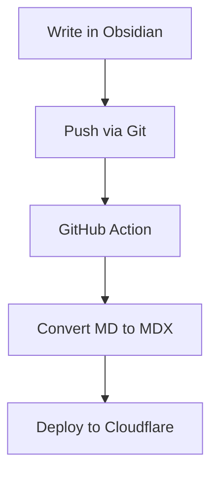

# Pipeline Test

This post tests the conversion pipeline from Obsidian to Astro MDX.

## Standard Markdown

Regular **bold**, *italic*, and `inline code` should pass through unchanged.

- List item one
- List item two

## Obsidian-Specific Syntax

Wikilink: [[Some Internal Note]]

Wikilink with alias: [[Some Internal Note|display text]]

Highlight: ==this should become a mark tag==

Obsidian comment: %%this should be stripped entirely%%

Inline tag: #some-tag should be removed

> [!info] Callout Test
> This Obsidian callout should be converted to an Astro Callout component.

> [!warning] Watch Out
> Multi-line callout content.
> Second line of the callout.

## Code Blocks

```javascript
const x = 42;
console.log(x);
```

## Math (auto-detected)

Inline math: $E = mc^2$

Display math:

$$
\int_0^1 x^2 \, dx = \frac{1}{3}
$$

## Mermaid (auto-detected)


